<p align="center">
  
</p>

<p align="center">
  <b>English</b> · <a href="README.zh-CN.md">简体中文</a>
</p>

<p align="center">
  <a href="https://summerpapaya.github.io/meow-blossom-haven/"><b>▶ Live demo</b></a>
</p>

# Meow Blossom Haven

An interactive, dreamy 3D home for **Peach (猪猪)**, a ragdoll cat — five floating islands, each with its own cat tree, bed, tunnel and toys, wrapped in a soft fairy-tale atmosphere. Everything is built procedurally with [three.js](https://threejs.org) in a single HTML file: no models, images or audio files to download.

## Highlights

- **Five islands**, reached through a cat-eared "anywhere door":
  - 🌸 **Blossom Meadow** — giant flowers, a plush flower cat tree, a fuzzy peach-shaped cat cave
  - 🌙 **Moonlit Cloud Isle** — cotton-soft clouds, crescent moons, a rainbow
  - 🍭 **Candy Tea Party** — dessert-stand cat tree, cupcake bed, floating cotton candy
  - 🐳 **Ocean Deep** — coral and kelp under an air bubble, whales, manta rays and jellyfish gliding past
  - 🌲 **Forest Treehouse** — giant trees, a treehouse, squirrels, birds, an owl and rabbits
- **Peach lives her own life**: strolls, grooms, naps, climbs, plays and uses the litter box, finding her way around furniture.
- **Interactions**: pet, brush, scoop the litter, yarn ball, feather wand, climb, tunnel, feed, nap — or click things in the scene.
- **Living world**: four seasons, dawn / day / dusk / night (starts at your local time of day), clear / cloudy / rain / snow. Her pupils narrow in daylight and widen at night.
- **Sound**, all synthesised: a music-box lullaby or a 3/4 waltz, purring, rain, wind, birdsong.
- **中文 / English** interface, switchable at any time.

## Quick start

The page loads three.js as ES modules, so it must be served over HTTP (opening the file directly with `file://` will not work).

```bash
python3 -m http.server 8791 --bind 127.0.0.1
```

Then open <http://localhost:8791/>. Any static host (GitHub Pages, Netlify, …) works too.

An internet connection is needed on first load for three.js (jsDelivr) and the title font (Google Fonts).

## Controls

| Action | How |
| --- | --- |
| Orbit / zoom | Drag / scroll (pinch on touch screens) |
| Interact | Click Peach, toys or furniture, or use the buttons at the bottom |
| Island, season, time, weather, music | The round buttons on the right |
| Follow Peach | 👀 |
| Language | 中 / EN |

## Browser support

Recent Chrome, Edge, Safari and Firefox with WebGL 2. The scene lowers its own quality (resolution, grass density, shadows, bloom) if the frame rate drops.

## Privacy

- No accounts, analytics, cookies or tracking.
- `localStorage` stores one value: your language choice.
- Requests leave your machine only for the pinned three.js modules (jsDelivr) and the title font (Google Fonts, which sees your IP address). Self-host both if that matters for your audience.

## Security

- three.js is pinned to `0.160.0`, and every module is checked with Subresource Integrity hashes; a modified file is refused by the browser.
- A Content-Security-Policy limits the page to itself, jsDelivr and Google Fonts.
- No user input is ever written into the page as HTML.

## Development

- Everything lives in `index.html`, organised in commented sections (renderer, fur shader, islands, Peach, behaviour, audio, UI).
- `?auto` skips the start screen; `?debug` exposes a `window.peach` object for inspection and scripted testing.
- If you upgrade three.js, regenerate the `integrity` hashes in the import map.

## Credits

- [three.js](https://github.com/mrdoob/three.js) — MIT License
- [Cormorant Garamond](https://fonts.google.com/specimen/Cormorant+Garamond) — SIL Open Font License 1.1

## License

- **Code**: [MIT](LICENSE) — use, modify and share freely, keeping the copyright notice.
- **Character & artwork**: [CC BY-NC 4.0](LICENSE-ART) — Peach (猪猪), her likeness, the scene designs and the images in `assets/` may be shared and adapted for non-commercial use with credit. Commercial use needs permission.
