<p align="center">
  
</p>

<p align="center">
  <a href="README.md">English</a> · <b>简体中文</b>
</p>

# Meow Blossom Haven · 猪猪的喵喵仙境

为布偶猫**猪猪（Peach）**打造的梦幻 3D 互动小屋：五座漂浮仙岛，每座都有专属的猫爬架、猫窝、隧道和玩具，笼罩在柔和的童话氛围里。整个项目用 [three.js](https://threejs.org) 在一个 HTML 文件里程序化生成，不需要下载任何模型、图片或音频文件。

## 亮点

- **五座浮空岛**，穿过猫耳朵形状的"任意门"往来：
  - 🌸 **花境**：巨型花朵、毛绒花朵猫爬架、毛茸茸的桃子猫窝
  - 🌙 **云月屿**：棉花般柔软的云朵、弯月、彩虹
  - 🍭 **甜梦茶会**：甜品架猫爬架、纸杯蛋糕猫窝、漂浮的棉花糖
  - 🐳 **深海秘境**：气泡结界里的珊瑚与海藻，鲸鱼、魔鬼鱼、水母从身边游过
  - 🌲 **森林树屋**：参天大树、树屋，还有松鼠、小鸟、猫头鹰和兔子
- **猪猪有自己的生活**：散步、舔毛、睡觉、爬架、玩耍、上厕所，会自己绕开家具找路。
- **互动**：摸摸、梳毛、铲屎、毛线球、逗猫棒、爬花架、钻隧道、吃饭、睡觉，也可以直接点击场景里的东西。
- **会变化的世界**：春夏秋冬；晨、昼、暮、夜（打开时按你所在地的当前时间）；晴、云、雨、雪。猪猪的瞳孔白天收窄、夜里放大。
- **声音**全部实时合成：八音盒摇篮曲或三拍子圆舞曲、呼噜声、雨声、风声、鸟鸣。
- **中文 / English** 界面，随时切换。

## 快速开始

页面以 ES 模块方式加载 three.js，需要通过 HTTP 访问（直接双击用 `file://` 打开无法运行）。

```bash
python3 -m http.server 8791 --bind 127.0.0.1
```

然后打开 <http://localhost:8791/peach-cottage.html>。也可以部署到任何静态托管（GitHub Pages、Netlify 等）。

首次打开需要联网，用于加载 three.js（jsDelivr）和标题字体（Google Fonts）。

## 操作

| 操作 | 方式 |
| --- | --- |
| 旋转 / 缩放视角 | 拖拽 / 滚轮（触屏双指） |
| 互动 | 点击猪猪、玩具或家具，或使用底部按钮 |
| 切换浮空岛、季节、天光、天气、音乐 | 右侧的圆形按钮 |
| 镜头跟随猪猪 | 👀 |
| 切换语言 | 中 / EN |

## 浏览器支持

支持 WebGL 2 的新版 Chrome、Edge、Safari、Firefox。帧率不足时会自动降低画质（分辨率、草地密度、阴影、泛光）。

## 隐私

- 没有账号、统计、Cookie 或任何追踪。
- `localStorage` 只保存一项：你选择的界面语言。
- 只有两类请求会离开你的设备：固定版本的 three.js 模块（jsDelivr），以及标题字体（Google Fonts，会看到你的 IP 地址）。如果你的用户对此敏感，可以把两者改为自托管。

## 安全

- three.js 固定为 `0.160.0` 版本，每个模块都带子资源完整性（SRI）校验，文件被篡改时浏览器会拒绝加载。
- 内容安全策略（CSP）限定页面只能从自身、jsDelivr 和 Google Fonts 加载资源。
- 不会把任何用户输入作为 HTML 写入页面。

## 开发

- 所有代码都在 `peach-cottage.html` 里，按注释分区（渲染器、毛发着色器、各浮空岛、猪猪、行为、音频、界面）。
- `?auto` 跳过开场界面；`?debug` 暴露 `window.peach` 对象，便于调试和脚本化测试。
- 升级 three.js 版本时，需要重新生成导入映射（import map）里的 `integrity` 哈希。

## 致谢

- [three.js](https://github.com/mrdoob/three.js) —— MIT 许可证
- [Cormorant Garamond](https://fonts.google.com/specimen/Cormorant+Garamond) —— SIL 开放字体许可证 1.1

## 许可证

- **代码**：[MIT](LICENSE)，可自由使用、修改和分发，需保留版权声明。
- **角色与美术**：[CC BY-NC 4.0](LICENSE-ART)，猪猪（Peach）的名字和形象、各场景的视觉设计以及 `assets/` 中的图片，可在署名的前提下用于非商业用途的分享和改编；商业用途需事先获得许可。
